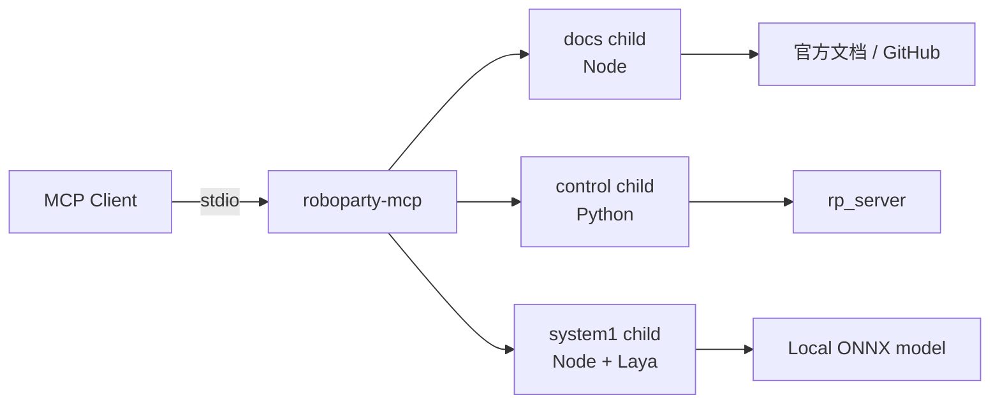

<div align="center">

# RoboParty MCP

**一个 MCP 入口，连接文档、控制与 System-1。**

把 RoboParty 的文档检索、机器人控制和 Laya 决策分析统一成一套命名空间工具，供 Claude Code、Cursor、Codex 等 MCP 客户端直接调用。

[](LICENSE)
[](https://github.com/Roboparty/roboparty_mcp/releases)
[](package.json)
[](https://modelcontextprotocol.io)
[](https://www.npmjs.com/package/roboparty-mcp)

</div>

---

## 为什么需要统一入口？

RoboParty 的能力原本分散在三个 MCP 中。`roboparty-mcp` 把它们收进一个 npm 包、一个 stdio 入口：

- **一个客户端配置**：只注册一个 MCP server。
- **统一工具命名**：`docs_*`、`control_*`、`system1_*`，路由清晰。
- **凭据隔离**：只有控制子进程能看到 rp_server token。
- **按需启用**：只开文档、只开控制，或三个全开。
- **可独立演进**：三个子服务仍是独立进程，代码和生命周期互不耦合。

## 三个子服务

| 子服务 | 工具前缀 | 运行时 | 能力 |
|---|---|---|---|
| 文档 MCP | `docs_*` | Node | 检索官方文档、RP1 GitHub 文档、目录与页面 |
| 控制 MCP | `control_*` | Python 子进程 | 经 rp_server protocol v2 读取状态、控制与遥测 |
| System-1 MCP | `system1_*` | Node | 本地 Laya ONNX 决策分析 |



## 举个例子

```text
docs_search_docs          → 查官方文档
docs_get_page             → 打开原文
control_get_imu           → 读取 IMU
control_get_battery       → 读取电池
control_policy_start      → 启动策略（需可写配置与 lease）
system1_laya_analyze      → 让 Laya 分析当前局面
```

原工具名、参数和返回结构保持不变，只在前面增加子服务前缀。

## 安装

### npm（待发布）

```bash
npm install -g roboparty-mcp
```

当前公共 npm 源尚未发布，请先用下面的 GitHub Release 安装包。

### GitHub Release 安装包

如果暂时不使用 npm，可以从 Release 下载 `.tgz` 后本地安装：

```bash
gh release download --repo Roboparty/roboparty_mcp \
  --pattern 'roboparty-mcp-*.tgz' --dir /tmp/roboparty-mcp

npm install -g /tmp/roboparty-mcp/roboparty-mcp-*.tgz
```

### 从源码运行

```bash
git clone https://github.com/Roboparty/roboparty_mcp.git
cd roboparty_mcp
npm ci --ignore-scripts
npm run build
node src/index.mjs --check
```

> 公共 npm 源发布尚未启用；优先使用 Release 安装包。

## 快速开始

```bash
# 全部子服务
roboparty-mcp

# 只启用文档与 System-1
roboparty-mcp --profile docs,system1

# 只启用控制
roboparty-mcp --profile control

# 检查子进程和工具列表
roboparty-mcp --check
```

MCP 客户端配置示例：

```json
{
  "mcpServers": {
    "roboparty": {
      "command": "npx",
      "args": ["-y", "roboparty-mcp"]
    }
  }
}
```

如果使用全局安装或本地 tgz，把 `command` / `args` 改成对应可执行文件路径即可。

## 首次配置

### 控制子进程

需要 Python 3.10+、`pyyaml` 和 `protobuf`：

```bash
roboparty-mcp --setup
```

控制凭据只在控制子进程中注入：

```bash
export RP_SERVICE_TOKEN='<rp_server service token>'
export RP_TLS_CERT='/path/to/robot-cert.pem'   # 可选
export MCP_CONFIG='/path/to/mcp.yaml'          # 可选
```

### System-1 / Laya

模型约 1.7GB，不随 npm 包分发：

```bash
roboparty-mcp --fetch-model
```

默认缓存到 `~/.cache/receptron-laya`（Windows 为 `%USERPROFILE%\.cache\receptron-laya`）。
支持 `LAYA_CACHE`、`LAYA_MIRROR`、`LAYA_REVISION`、`LAYA_SUBFOLDER`。

## Profile 与工具路由

| Profile | 启动的子服务 | 典型场景 |
|---|---|---|
| `docs` | 文档 | 只查资料，不碰机器人 |
| `control` | 控制 | 只做状态读取或控制 |
| `system1` | System-1 | 只做 Laya 分析 |
| `docs,control` | 文档 + 控制 | 查文档后执行 |
| `docs,system1` | 文档 + System-1 | 查资料 + 分析 |
| `docs,control,system1` | 全部 | 默认 |

统一入口只负责工具发现和路由，不复制 rp_server 的认证、lease、stop 或遥测逻辑。

## 凭据隔离

| 变量 | docs | control | system1 |
|---|---:|---:|---:|
| `RP_SERVICE_TOKEN` | 否 | 是 | 否 |
| `RP_TLS_CERT` | 否 | 是 | 否 |
| `MCP_CONFIG` | 否 | 是 | 否 |
| `RP_ALLOW_PLAINTEXT` | 否 | 是 | 否 |
| 代理 / 缓存变量 | 按需 | 按需 | 按需 |

控制子进程默认 `readonly: true`；运动、策略启停等写操作仍需要可写配置和 control lease。

## 安全边界

- 文档和 System-1 子进程拿不到控制 token。
- 工具调用成功不等于硬件动作完成；控制结果要结合 rp_server v2 回执和 telemetry。
- System-1 输出只是分析建议，不是设备授权。
- `control_stop`、策略启停、使能等动作不得绕过 rp_server 的权限和 lease 校验。
- 不要把 token 写进 URL、README、日志或 MCP 客户端配置仓库。

## 包内容

```text
src/docs/          文档 MCP（TypeScript）
src/system1/       System-1 MCP（TypeScript）
src/control/       控制 MCP（Python + roboparty.v1 + 启动器）
dist/              构建产物：docs / system1 bundle
scripts/           构建、版本检查、模型下载
```

- 三个子服务的源码都在本包内，不再依赖独立的 `roboparty-docs-mcp`、`roboparty-control-mcp`、`roboparty-system1-mcp`。
- Skills 不在本包分发，统一放在 [Roboparty/roboparty_skills](https://github.com/Roboparty/roboparty_skills)。
- 如果 `onnxruntime-node` 安装时下载失败：

```bash
ONNXRUNTIME_NODE_INSTALL=skip npm ci --ignore-scripts
roboparty-mcp --fetch-model
```

## 开发

```bash
npm ci --ignore-scripts
npm run typecheck
npm run build
npm test
node src/index.mjs --check
```

发布前检查版本与 tag 一致：

```bash
node scripts/check-version.mjs v0.1.9
```

## 相关链接

- Skills：[Roboparty/roboparty_skills](https://github.com/Roboparty/roboparty_skills)
- 文档中心：<https://roboparty.com/roboto_origin/doc>
- Issues：[GitHub Issues](https://github.com/Roboparty/roboparty_mcp/issues)
- 安全策略：[SECURITY.md](SECURITY.md)

## License

GPL-3.0-only，见 [LICENSE](LICENSE)。
